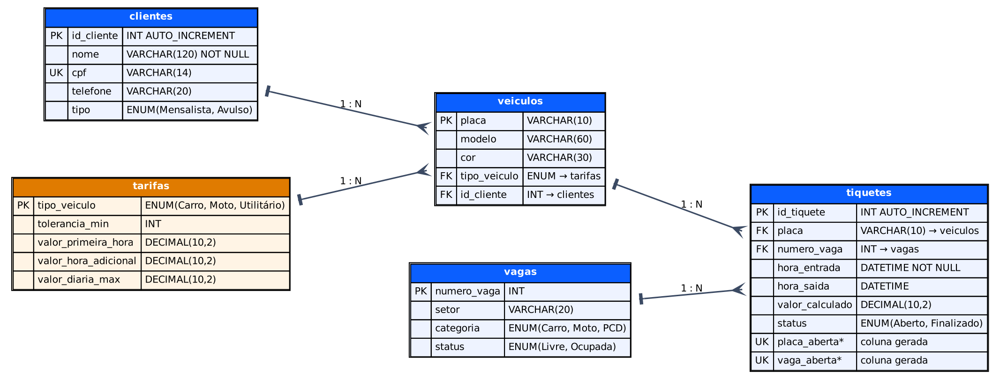

# AutoPark

Sistema de gerenciamento de estacionamento com banco de dados **MySQL**, uma aplicação de cadastro em **PHP** e um sistema de operação em **Python (Flask)**.


Projeto da disciplina de **Banco de Dados**, com orientação do professor **Gean Paulo**.

## O problema

O AutoPark é um estacionamento comercial em zona urbana central que controla entradas, saídas e mensalistas em **fichas de papel**. Isso causa filas nos horários de pico, erros no cálculo da permanência e perda de controle sobre as vagas livres.

O problema principal é a **incerteza na ocupação das vagas** e a **lentidão no faturamento por hora**. A solução proposta é um banco de dados que automatiza tíquetes, vagas e mensalistas, para dar agilidade à recepção e precisão ao caixa.

## Funcionalidades

- **Painel do pátio:** vagas livres e ocupadas em tempo real, com o tempo de cada veículo.
- **Entrada:** reconhece a placa, escolhe a vaga livre da categoria certa (carro, moto ou PCD) e gera o tíquete.
- **Saída:** calcula a permanência e o valor pela tarifa do tipo de veículo e libera a vaga.
- **Mensalistas:** cadastrados como clientes e isentos da cobrança por hora.
- **Caixa:** fechamento por dia, com cada saída e o total arrecadado.
- **Cadastros:** clientes, veículos e vagas.
- **Integridade no banco:** o próprio MySQL impede dois tíquetes abertos para a mesma placa ou a mesma vaga.

## Tecnologias

| Camada | Tecnologia |
| --- | --- |
| Banco de dados | MySQL 5.7 ou 8.x (InnoDB, utf8mb4) |
| Cadastro | PHP 8 com PDO |
| Sistema de operação | Python 3 com Flask e PyMySQL |

## Modelo de dados

Cinco tabelas: `clientes`, `veiculos`, `vagas`, `tiquetes` e `tarifas`.



O modelo conceitual está em [`docs/modelo_conceitual.png`](docs/modelo_conceitual.png) e a descrição de cada tabela em [`docs/modelos.md`](docs/modelos.md).

## Como rodar

**1. Criar a base de dados** (recria o banco `autopark` do zero):

```bash
mysql -u root -p < autopark_mysql.sql
```

**2. Aplicação PHP de cadastro:**

```bash
cd php
php -S localhost:8080
```

Acesse http://localhost:8080 (clientes) e http://localhost:8080/veiculos.php (veículos).

**3. Sistema de operação (Flask):**

```bash
pip install -r requirements.txt
python app.py
```

Acesse http://localhost:5000.

As duas aplicações leem a conexão das variáveis de ambiente `DB_HOST`, `DB_PORT`, `DB_NAME`, `DB_USER` e `DB_PASSWORD` (padrão: `localhost`, `3306`, `autopark`, `root` e senha vazia). Se o seu `root` tem senha, defina `DB_PASSWORD` antes de rodar.

No Windows (PowerShell): `$env:DB_PASSWORD="sua_senha"`. No Linux ou macOS: `export DB_PASSWORD=sua_senha`.

Sem MySQL instalado, `docker compose up -d` sobe um MySQL 8 de desenvolvimento (senha do `root`: `autopark`).

## Consultas SQL

São 10 consultas em [`sql/03_consultas.sql`](sql/03_consultas.sql), com enunciado, código e resultado em [`docs/consultas_resultados.md`](docs/consultas_resultados.md). Elas usam funções de agregação, `GROUP BY`, `HAVING`, `JOIN`, `LIKE` e `BETWEEN`.

## Estrutura do repositório

```
autopark/
├── autopark_mysql.sql     base completa: banco, tabelas e dados
├── sql/                   modelo físico, dados e consultas
├── php/                   aplicação de cadastro em PHP
├── app.py                 sistema de operação em Flask
├── docs/                  modelos, resultados das consultas e guia completo
├── requirements.txt
└── docker-compose.yml
```

## Regras de cobrança

Ficam na tabela `tarifas` e podem ser alteradas sem mexer no código. Os valores abaixo são uma suposição do projeto e precisam ser confirmados com o AutoPark.

| Tipo | Tolerância | 1ª hora | Hora adicional | Teto por 24 h |
| --- | --- | --- | --- | --- |
| Carro | 10 min | R$ 10,00 | R$ 5,00 | R$ 50,00 |
| Moto | 10 min | R$ 6,00 | R$ 3,00 | R$ 30,00 |
| Utilitário | 10 min | R$ 14,00 | R$ 7,00 | R$ 70,00 |

## Status do projeto

Os cálculos de tarifa, as telas, as rotas do Flask, o cadastro em PHP e as 10 consultas foram testados, mas com **SQLite no lugar do MySQL**. Rode `autopark_mysql.sql` no seu MySQL e compare os resultados das consultas com [`docs/consultas_resultados.md`](docs/consultas_resultados.md). O passo a passo completo, com solução de problemas comuns, está em [`docs/guia_completo.md`](docs/guia_completo.md).

## Autores

| Nome | GitHub |
| --- | --- |
| Diego de A. C. Moreira | [@iwnldev](https://github.com/iwnldev) |
| Yago de A. C. Santiago | [@Yacs05](https://github.com/Yacs05) |

## Agradecimentos

- Yago de Azevedo Cerqueira Santiago (https://github.com/Yacs05), pela ajuda no desenvolvimento do projeto.
- Professor Gean Paulo, pela orientação.
